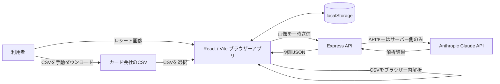

# レシート家計簿アプリ 設計書

## 1. 概要

本アプリは、レシート画像またはクレジットカード会社から利用者がダウンロードしたCSVを取り込み、支出の明細・カテゴリ・月次推移を管理するブラウザー向け家計簿である。

家計データは利用中のブラウザーのローカルストレージに保存する。レシート画像解析だけはNode.jsサーバーを経由してAnthropic Claude APIを呼び出す。カード会社へのログインや明細の自動取得は行わない。

## 2. 目的と対象範囲

### 目的
- レシート画像から商品、金額、日付、カテゴリを読み取り、登録作業を減らす。
- カード利用明細CSVから支出をまとめて取り込む。
- 月別・カテゴリ別に支出を確認できるようにする。
- ブラウザーの再読み込み後も登録済みデータを保持する。

### 対象範囲
- レシート画像のアップロードとClaudeによる内容解析
- カード明細CSVのローカル読込、列対応付け、プレビュー、登録
- 明細の月別表示、カテゴリ絞り込み、個別削除
- カテゴリ別円グラフ、直近6か月の支出棒グラフ
- ローカルストレージへの家計明細保存

### 対象外
- クレジットカード会社へのログイン、OAuth認証、スクレイピング
- カード会社APIや銀行口座との自動同期
- ユーザーアカウント、クラウド保存、複数端末間の同期
- CSVファイルそのものの保存・サーバーへの送信

## 3. 技術構成

| 領域 | 技術 | 用途 |
|---|---|---|
| フロントエンド | React 19 / TypeScript / Vite | ダッシュボード、入力、明細表示 |
| グラフ | Chart.js / react-chartjs-2 | カテゴリ別・月別支出の可視化 |
| CSV解析 | Papa Parse | 見出し付きCSVのブラウザー内解析 |
| バックエンド | Node.js / Express 5 / TypeScript | レシート解析API、開発時のAPI提供 |
| AI解析 | Anthropic Claude API (`claude-haiku-5-5`) | レシート画像から明細を抽出 |
| 永続化 | Browser localStorage | 家計明細の端末内保存 |

## 4. システム構成

### データ経路
- レシート画像はブラウザーからExpressの解析APIへ送られ、Claude APIへ転送される。画像はアプリの永続領域には保存しない。
- カードCSVはブラウザー内で解析し、サーバーへ送信しない。アプリはカード会社のログイン情報を受け取らない。
- Claude APIキーはNode.jsサーバーの環境変数から読み込み、ブラウザーに返さない。

## 5. 画面設計

### 家計ダッシュボード
- 集計対象年月を前後に移動する。
- 月の支出合計、明細件数、1件あたりの平均額を表示する。
- カテゴリ別支出をドーナツグラフ、直近6か月の合計支出を棒グラフで表示する。
- 指定月の明細を一覧表示し、カテゴリで絞り込む。
- 明細を個別削除する。
- 初期状態では画面確認用サンプル明細を表示する。CSV取込時はサンプル明細を実データと混在させず除去する。

### レシート取込
1. 画像を選択または画面へドロップする。
2. JPEG、PNG、WebP、GIFの画像を受け付ける。上限は8MB。
3. ブラウザー上のトリミング画面で画像上をドラッグし、必要な領域を自由な矩形で直接指定する。
4. 選択した領域をCanvasでJPEG画像にし、切り抜き後の画像だけを `/api/receipts/parse` へ送る。
5. 解析結果の商品名、金額、カテゴリ、店舗名、日付を確認する。
6. 確認後、明細をローカルストレージに追加する。

### カード明細CSV取込
1. 利用者がカード会社のサイト等からCSVをダウンロードする。
2. 「カード明細CSV」からCSVファイルを選択する。
3. UTF-8を優先し、読み取れない場合はShift-JISとして読み込む。ファイル上限は10MB。
4. 見出しから日付・利用先・金額列を推定する。推定結果は利用者が変更できる。
5. 有効行、カテゴリ推定結果、重複、対象外行をプレビューする。表の先頭8行を表示する。
6. 利用者が確定した行を既存明細に追加する。
7. 取込結果は月次合計、カテゴリ集計、グラフへ反映される。

## 6. データ設計

### ExpenseItem

| フィールド | 型 | 説明 |
|---|---|---|
| `id` | string | 明細を識別するUUID。 |
| `date` | string | 利用日。`YYYY-MM-DD`形式。 |
| `store` | string | 店舗名またはカードCSV上の利用先。 |
| `name` | string | 商品名。カードCSV明細では「カード利用」。 |
| `amount` | number | 円単位の整数。浮動小数点の金額計算は行わない。 |
| `category` | Category | `食費`、`日用品`、`外食`、`交通費`、`その他`のいずれか。 |
| `source` | `card` \| `receipt` \| undefined | データ由来。カードCSVは`card`、レシートは`receipt`。既存データ互換のため省略可能。 |

### 保存形式
- キー：`mainichi-kakeibo-expenses-v1`
- 値：`ExpenseItem[]` をJSON文字列として保存する。
- 保存先：アプリを利用するブラウザーのローカルストレージ。
- 画像、CSV原本、カード番号、認証情報は保存しない。

## 7. CSV取込仕様

### 対応列

| 用途 | 見出しの推定例 |
|---|---|
| 利用日 | 利用日、ご利用日、取引日、年月日、日付、date |
| 利用先 | 利用店名、利用店舗、ご利用先、加盟店名、摘要、店名、merchant、description |
| 金額 | 利用金額、ご利用金額、支払金額、支払額、金額、amount |

列名が推定できない場合やカード会社独自の見出しの場合は、プレビュー画面で列を選択する。

### 正規化と除外
- 日付は`YYYY/MM/DD`、`YYYY-MM-DD`、日本語表記、月/日/年表記、Excelシリアル値を受け付ける。
- 金額は全角文字、カンマ、円記号、空白を除いて円整数に変換する。
- 利用先のキーワードから食費、日用品、外食、交通費を推定し、判定できない場合はその他とする。
- 日付、利用先、金額のいずれかが無効な行を対象外とする。
- 0円以下の行（返品、支払・返金等）は支出明細に取り込まない。
- 同一CSV内または既存のカード由来明細に、正規化後の日付・利用先・金額が一致する行があれば重複扱いとする。
- 取込確認画面では、取込予定件数、重複件数、対象外件数を表示する。

## 8. API設計

### `GET /api/health`
- 用途：サーバー稼働とAPIキー設定有無を確認する。
- 応答例：`{"status":"ok","configured":true}`
- キーの値は返さない。

### `POST /api/receipts/parse`
- 用途：レシート画像をClaude APIで解析する。
- リクエスト：JSONの`image`（Base64文字列）と`mediaType`。
- 許可する画像形式：JPEG、PNG、WebP、GIF。
- 成功応答：`date`、`store`、`items[]`（`name`、`amount`、`category`）。
- 主なエラー：入力不正はHTTP 400、キー未設定はHTTP 503、解析失敗はHTTP 502。
- APIキーはサーバーの`ANTHROPIC_API_KEY`から取得する。

## 9. カテゴリ分類

- レシート明細：Claudeへカテゴリ候補を指定して分類を依頼する。
- カード明細：利用先文字列に対するキーワードルールで分類する。
- 自動分類結果はCSVの確認画面に表示する。登録後は一覧のカテゴリ表示と集計に使う。
- 分類語彙を増やす場合は`src/cardCsv.ts`の`guessExpenseCategory`を更新し、未知の利用先は「その他」にする。

## 10. セキュリティとプライバシー

- 実際の`.env`はGitに含めない。共有する`.env.example`には変数名と空の値だけを記載する。
- `ANTHROPIC_API_KEY`をフロントエンドのコードやビルド成果物へ含めない。
- レシート画像はブラウザーで切り抜き、切り抜き後の画像だけを解析のためサーバーへ一時送信する。元画像と切り抜き画像はアプリ側で永続化しない。
- カードCSVは端末内で処理し、カード会社のログイン情報を取得・保存しない。
- localStorageはブラウザー・端末単位の保存であり、暗号化、アカウント間分離、クラウドバックアップを提供しない。端末共有時はブラウザープロファイルを分ける。

## 11. 設定と実行

- Claude APIキー：`.env` の `ANTHROPIC_API_KEY`
- APIサーバーポート：`.env` の `PORT`（既定値 `3001`）
- 開発起動：`npm run dev`
- 型チェック・本番ビルド：`npm run build`
- 本番サーバー起動：`npm start`
- 開発時はViteからExpressのAPIサーバーへ `/api` をプロキシする。

## 12. 主なファイル構成

| パス | 役割 |
|---|---|
| `src/App.tsx` | ダッシュボード、レシート/CSV取込、集計、ローカル保存。 |
| `src/App.tsx` | レシート画像の矩形範囲選択、切り抜き、解析API送信。 |
| `src/cardCsv.ts` | CSVデコード、列名推定、日付・金額変換、カテゴリ推定、行検証。 |
| `src/data.ts` | localStorageキー、ローカル日付生成、サンプル明細。 |
| `src/types.ts` | カテゴリ、明細、レシート解析結果の型。 |
| `src/styles.css` | デスクトップ/モバイルの画面スタイル。 |
| `server/index.ts` | Expressヘルスチェック、レシート解析API、本番静的ファイル配信。 |
| `vite.config.ts` | Reactプラグインと開発時APIプロキシ設定。 |

## 13. 制約と今後の検討事項

- カード会社ごとにCSVの見出しや項目形式は異なるため、初回は列対応を確認する。カード会社別の専用プリセットは未実装。
- ローカルストレージはブラウザーデータ消去で失われる。バックアップ/エクスポート機能は未実装。
- カードCSV分類は利用先名のキーワード推定であり、誤分類時に明細を編集する機能は未実装。
- 同じ日付・利用先・金額の正当な複数取引も重複として判定される可能性がある。
- カードCSVの1行を1つの支出明細として扱う。商品単位への分解は行わない。

## 14. バージョン履歴と変更理由

### 現在のバージョン情報

- `package.json`に記載された現在のパッケージバージョンは`1.0.0`。
- Git管理を開始しており、現在の作業ブランチは`feature/manual-receipt-crop-selection`。
- `1.0.0`はpackage.json上のパッケージ表記であり、正式な製品リリースやタグを示すものではない。表の履歴は確認できた開発上の変更で、個別バージョンやリリース日を遡って割り当てない。

### 変更履歴

| 時点・バージョン | 変更内容 | 変更理由 |
|---|---|---|
| 初期実装（現行パッケージ表記：`1.0.0`。正式リリース番号かは未確認） | React/Viteの家計ダッシュボード、月別・カテゴリ別グラフ、ローカルストレージ保存、Claudeによるレシート解析APIを実装。 | レシートから収支を記録し、ブラウザー内で支出を継続して確認できる基本機能を提供するため。 |
| カード明細CSV取込の追加（パッケージ表記は`1.0.0`のまま） | Papa ParseによるCSV読込、文字コード判定、列の自動推定と手動対応、取込プレビュー、カテゴリ推定、重複・対象外行の除外を追加。 | 毎回レシートを撮影する手間を減らすため。また、カード会社へのログイン情報をアプリに預けず、利用者が取得した明細だけを端末内で扱うため。 |
| レシート画像トリミングの追加（パッケージ表記は`1.0.0`のまま） | 当初は固定枠に合わせて画像位置と拡大率を調整する方式を追加。 | レシート上の必要領域に絞って解析し、不要な情報の送信を減らすため。 |
| レシートの直接範囲選択への変更（作業ブランチ：`feature/manual-receipt-crop-selection`、パッケージ表記は`1.0.0`のまま） | 固定枠・ズーム方式をやめ、画像上をドラッグして自由な矩形範囲を直接指定する方式に変更。選択範囲を自然画像のピクセル座標へ変換し、Canvasで切り抜いたJPEGだけを解析APIへ送る。 | 利用者が品目名・金額・総額など必要な領域を直感的に囲めるようにし、固定比率に合わせる手間や範囲調整の分かりにくさをなくすため。 |
| セキュリティ設定例の修正 | 共有用`.env.example`のAPIキー欄を空にし、変数名とポート設定のみを残した。 | APIキーの実値を共有ファイルやGitへ含めないため。 |
| 設計書の履歴管理追加 | 本節に確認可能な変更内容、理由、履歴上の制約を記録。 | 変更の背景を明確にし、後続の機能追加や保守で判断根拠をたどれるようにするため。 |

### 今後のバージョン付与ルール

- 互換性を保った不具合修正や小さな改善はパッチ番号を上げる（例：`1.0.0`から`1.0.1`）。
- 既存利用方法と互換性のある機能追加はマイナー番号を上げる（例：`1.0.0`から`1.1.0`）。
- 保存データ形式や利用方法に互換性のない変更はメジャー番号を上げる（例：`1.0.0`から`2.0.0`）。
- リリース時は`package.json`のバージョン、変更内容、変更理由をこの表へ追記し、Gitタグを作成する場合はタグ名も併記する。